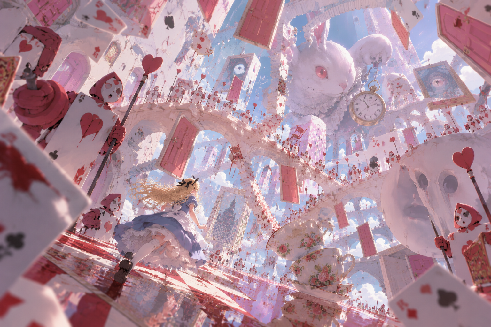
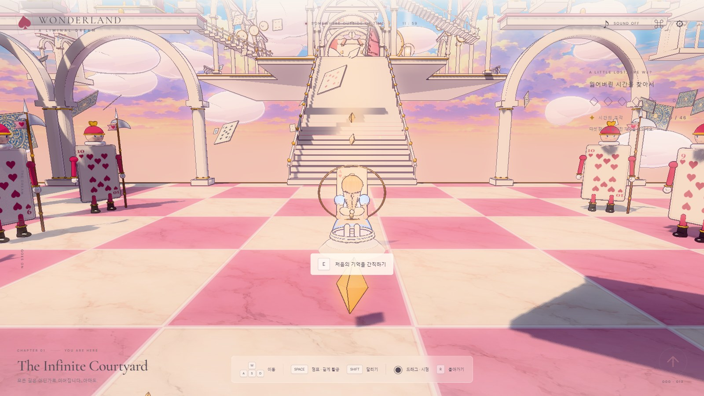
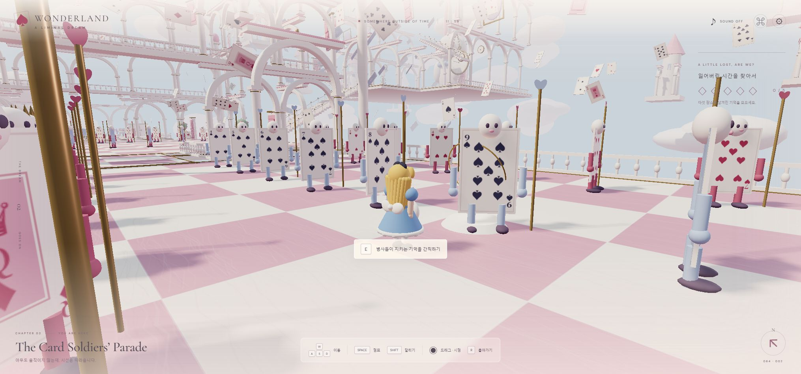
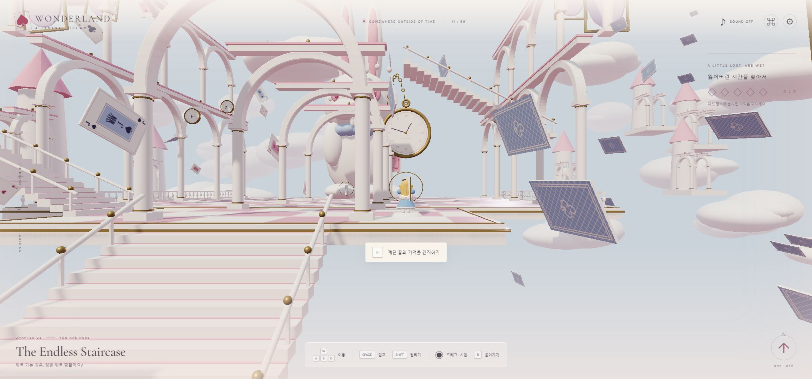
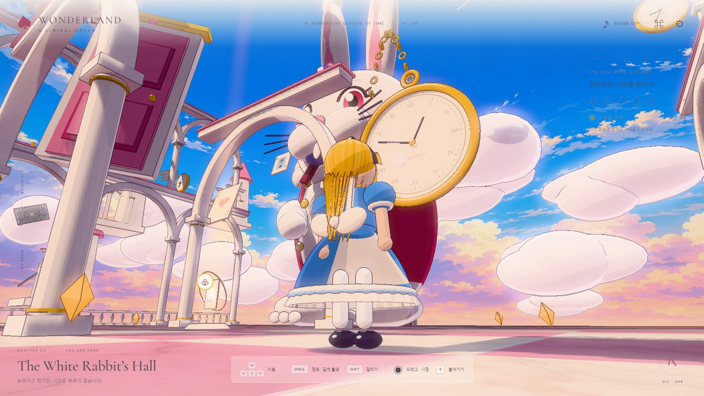
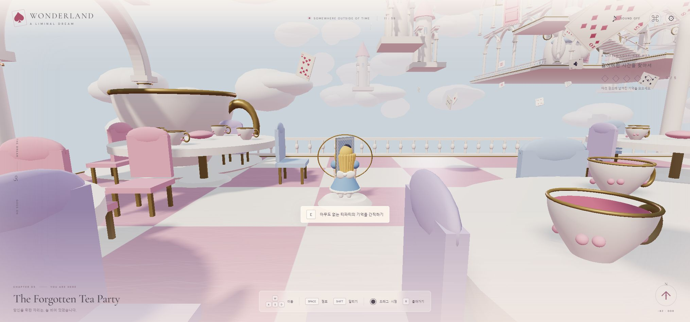

<div align="center">

<sub>W O N D E R L A N D</sub>

# A Liminal Dream

**아름다운 곳에서, 조금씩 길을 잃는 게임.**

햇빛에 잠긴 회랑. 말하지 않는 병사들. 멈추지 않는 열한 시 오십구 분.<br>
앨리스를 조작해 다섯 개의 공간을 걷고, 잃어버린 시간의 조각을 찾아보세요.

<p>
  
  
  
  
</p>

[빠른 실행](#quick-start) · [실제 게임 화면](#screenshots) · [다섯 공간](#five-chapters) · [조작법](#controls) · [개발 문서](docs/DEVELOPMENT.md)



<sub>VISUAL REFERENCE · 위 이미지는 제공된 콘셉트 레퍼런스입니다. 아래 스크린샷은 실제 브라우저에서 촬영했습니다.</sub>

</div>

---

> “여기서는, 길을 잃어도 괜찮아요.”

**WONDERLAND — A Liminal Dream**은 이상한 나라의 앨리스, 드림코어, 밝은 리미널 공간에서 영감을 받은 **플레이 가능한 3인칭 3D 탐험 게임**입니다. 어둠이나 점프스케어 대신, 지나치게 고요하고 완벽하게 정돈된 공간이 주는 낯섦을 담았습니다.

건축물, 계단, 토끼, 찻잔, 카드와 캐릭터는 실제 입체 지오메트리입니다. 직접 걷고, 달리고, 점프하며 연결된 세계를 탐험할 수 있습니다.

<a id="screenshots"></a>
## Inside the dream



<div align="center"><sub>01 · THE INFINITE COURTYARD — 꿈이 시작되는 곳</sub></div>

<table>
  <tr>
    <td width="50%"><br><b>02 · The Card Soldiers’ Parade</b><br><sub>움직이지 않는 병사들. 당신을 따라오는 시선.</sub></td>
    <td width="50%"><br><b>03 · The Endless Staircase</b><br><sub>서른여섯 계단 위에도, 또 다른 길이 있습니다.</sub></td>
  </tr>
  <tr>
    <td width="50%"><br><b>04 · The White Rabbit’s Hall</b><br><sub>살아 있는 걸까요. 아주 오래 기다렸을 뿐일까요.</sub></td>
    <td width="50%"><br><b>05 · The Forgotten Tea Party</b><br><sub>차는 식지 않았고, 당신의 자리는 비어 있습니다.</sub></td>
  </tr>
</table>

<sub>플레이 이미지는 이 저장소의 게임을 직접 렌더링한 화면입니다. 촬영용 검사 모드로 구역과 카메라 구도를 선택했습니다. 레퍼런스 이미지를 게임 배경으로 사용하지 않습니다.</sub>

<a id="quick-start"></a>
## Step into Wonderland

**패키지 설치와 빌드 없이, 정적 서버 하나로 시작합니다.**

```bash
git clone https://github.com/fdrn9999/alice-in-wonderland.git
cd alice-in-wonderland
npm start
```

브라우저에서 **[http://localhost:4173](http://localhost:4173)** 을 여세요.

Node.js 20.11 이상이 필요합니다. Python이 있다면 아래 명령으로도 실행할 수 있습니다.

```bash
python -m http.server 4173 --bind 127.0.0.1
```

Three.js **0.180.0**을 CDN에서 가져오므로 인터넷 연결이 필요합니다. API 키, 계정, 유료 에셋은 필요하지 않습니다. ES Modules를 사용하므로 `index.html`을 더블클릭하는 대신 HTTP 서버로 실행하세요. WebGL2를 지원하는 데스크톱 브라우저에서 플레이합니다.

## A little lost, are we?

**각 구역에 남겨진 금빛 기억 카드 하나씩, 모두 다섯 개를 모으세요.**

- **Explore** — WASD와 마우스로 둘러보고, 계단과 공중 다리를 직접 건너갑니다.
- **Notice** — 가까이 다가가면 일부 병사가 아주 천천히 고개를 돌립니다.
- **Interact** — `E`로 기억을 수집하고, 문을 열고, 시계와 티파티에 다가갑니다.
- **Remember** — 새로운 장소는 체크포인트가 됩니다. 발견한 곳은 지도에서 다시 방문할 수 있습니다.
- **Stay** — 다섯 기억을 모으면 짧은 결말이 열립니다. 그 후에도 꿈속에 머무를 수 있습니다.

진행 상황은 브라우저에 자동 저장됩니다. 추락하면 마지막 체크포인트로 돌아옵니다. 서두를 필요는 없습니다.

<a id="five-chapters"></a>
## Five chapters, one impossible place

| | 장소 | 그곳에 남아 있는 것 |
|:--:|---|---|
| ♡ | **The Infinite Courtyard** | 분홍 체커보드, 3층 아케이드, 장미 나무와 하트 병사 |
| ♤ | **The Card Soldiers’ Parade** | 네 문양의 A–K 카드, 왕관을 쓴 병사와 정적인 열병 |
| ♢ | **The Endless Staircase** | 실제로 오르내리는 36단 계단, 공중 분기 계단과 떠 있는 문 |
| ♧ | **The White Rabbit’s Hall** | 거대한 흰 토끼, 금빛 회중시계, 서로 다른 시간을 가리키는 시계 |
| ♕ | **The Forgotten Tea Party** | 반복되는 빈 테이블, 파스텔 의자, 커다란 찻잔과 공중의 접시 |

안뜰의 양옆 다리로 열병장과 티파티에 갈 수 있습니다. 정면 계단을 오르면 상층 회랑과 토끼의 홀에 닿습니다. 분홍 문은 익숙한 길을 조금 다르게 연결합니다.

<a id="controls"></a>
## Make yourself at home

| 입력 | 기능 | 입력 | 기능 |
|---|---|---|---|
| `W A S D` | 카메라 방향 기준 이동 | 마우스 드래그 | 카메라 회전 |
| `Space` | 점프 | 마우스 휠 | 카메라 거리 조절 |
| `Shift` | 달리기 | `E` | 가까운 대상과 상호작용 |
| `R` | 체크포인트로 복귀 | `Tab` | 지도 열기 / 닫기 |
| `M` | 환경음 켜기 / 끄기 | `H` | HUD 표시 / 숨기기 |
| `ESC` | 마우스 잠금 해제 / 창 닫기 | 설정 | 품질·감도·볼륨·시점 반전 |

설정에서 **마우스 잠금으로 플레이**를 선택하면 드래그 없이 마우스 이동으로 시점을 돌릴 수 있습니다. 기본 모드는 드래그 방식입니다.

상단 **♪** 버튼으로 오르골, 바람, 초침과 발소리를 켜세요. 소리는 Web Audio로 합성하며 클릭 후 시작합니다. 성능이 부족하면 그래픽 품질에서 **가벼움**을 선택하세요. 터치 전용 이동 조작은 포함하지 않습니다.

## Built from a dream

| 구성 | 구현 |
|---|---|
| **World** | 절차적 건축과 조형물, 공간별 정적 메시 병합, 화면 밖 구역 컬링 |
| **Alice** | 금발·파란 드레스·흰 앞치마, 여섯 이동 상태와 보행·머리카락·드레스 애니메이션 |
| **Camera** | 부드러운 3인칭 Orbit 추적, 수직 범위 제한, 줌과 건축물 충돌 |
| **Physics** | 고정 90Hz 이동, 중력·점프·계단·벽·천장 충돌과 추락 복귀 |
| **Cards** | 52종 카드 아틀라스, 앞뒷면과 두께, 240장 InstancedMesh 카드 |
| **Light** | sRGB 색상 관리, ACES 톤 매핑, 그림자·안개·약한 Bloom |
| **Sound** | 외부 오디오 파일 없는 Web Audio 환경음 |
| **Progress** | 5개 기억, 문 이동, 발견한 장소의 빠른 이동, localStorage 저장 |

```text
alice-in-wonderland/
├── index.html                 # 게임 화면과 지도·설정·결말
├── style.css                  # 파스텔 HUD와 반응형 UI
├── server.mjs                 # 의존성 없는 로컬 정적 서버
├── src/
│   ├── main.js                # 게임 루프, 입력, 카메라, 진행
│   ├── world.js               # 건축, 카드, 토끼와 티파티
│   ├── character.js           # 교체 가능한 앨리스 모델
│   ├── physics.js             # 이동과 충돌
│   ├── audio.js               # 합성 환경음
│   └── qa.js                  # 실제 월드의 경로 검사
├── tests/physics.test.mjs      # 물리 회귀 테스트
└── docs/
    ├── DEVELOPMENT.md         # 구현·확장·검사 안내
    └── images/                # 레퍼런스와 실제 플레이 화면
```

앨리스는 `Alice.root`를 발바닥 기준으로 유지하고 `Alice.model`을 교체할 수 있도록 분리되어 있습니다. GLB와 AnimationMixer를 연결하는 방법은 [개발 문서](docs/DEVELOPMENT.md)를 참고하세요.

## Tested paths

```bash
npm run check
npm test
```

**6개 물리 회귀 테스트 + 실제 월드의 6개 이동 경로 검증을 통과했습니다.**

점프와 착지, 계단 왕복, 지상·공중 벽 충돌, 천장 충돌과 추락 복귀를 검사합니다. 실제 월드에서는 양옆 다리, 상층 기억, 토끼의 홀, 공중 분기 계단과 티파티의 의자 사이 동선을 확인했습니다. 브라우저에서 다섯 기억 수집, 새로고침 후 진행 복원, 문 이동, 완료 후 결말 표시도 확인했습니다.

<details>
<summary>개발자 검사 모드</summary>

`?diagnostics=1`로 좌표·상태·FPS·그리기 통계를 확인합니다. **실제 월드 충돌 경로 검증** 버튼은 별도의 물리 바디로 여섯 경로를 검사합니다.

`&inspect=0`부터 `&inspect=4`까지는 각 구역의 기억 근처에서 시작합니다. `&portal=0`부터 `&portal=5`까지는 문 앞에서 시작합니다. `&capture=1`은 진단 표시를 숨기고 촬영 구도를 선택합니다. 검사 모드에서 수집한 기억도 저장되므로, 검사를 마친 뒤 설정에서 진행을 초기화하세요.

</details>

---

<div align="center">

**All the time in the world.**

<sub>Built with HTML, CSS, JavaScript &amp; <a href="https://threejs.org/">Three.js</a> · Three.js is MIT licensed.<br>
상단 레퍼런스는 사용자가 제공한 이미지이며, 실제 플레이 화면과 구분해 표시했습니다.<br>
게임의 3D 오브젝트는 이 프로젝트에서 절차적으로 렌더링합니다.</sub>

</div>
